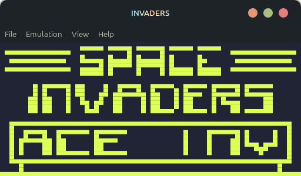
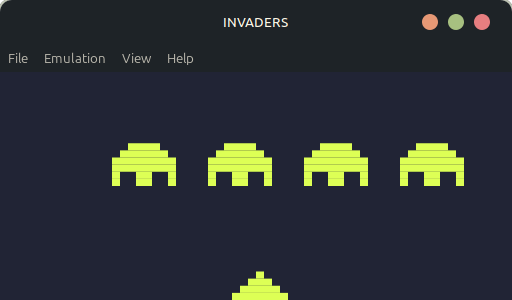

# CHIP8 Emulator

[](https://github.com/mstuttgart/chip8-emulator/actions/workflows/ci.yml) 

The CHIP8 Emulator is a freeware open source RCA COSMAC VIP emulator and CHIP-8 interpreter for 
GNU Linux, written in C. The emulator core (`src/chip8_cpu.c` and `src/chip8_system.c`)
has no dependency on any graphics library; two frontends are provided: an SDL2 one (`src/main.c`),
driven by the command line, and a GTK4 GUI (`src/gtk/main.c`) with menus and a native file chooser.
CHIP8 Emulator may be freely distributed, 
not for commercial purposes.If you want to reuse anything, go ahead, as long as you credit me, and your project is open source too.

<p align="center">
<a name="top" href="https://github.com/mstuttgart/chip8-emulator"></a>
</p>

## Downloads

Precompiled binaries for Linux are available on the
[Releases page](https://github.com/mstuttgart/chip8-emulator/releases).

Download the appropriate archive, extract it, and run the SDL2 or GTK4 binary
for your environment.

<p align="center">
<a name="top" href="https://github.com/mstuttgart/chip8-emulator"></a>
</p>

## Compiling

Make sure the SDL2 development libraries are installed. The GTK4 development libraries
are optional: when present, the GTK4 GUI frontend is built as well.

```
* In Ubuntu/Debian: sudo apt-get install build-essential pkg-config libsdl2-dev libgtk-4-dev
* In Fedora: sudo dnf install gcc make pkg-config SDL2-devel gtk4-devel
* In Arch Linux: sudo pacman -S base-devel pkgconf sdl2 gtk4
```

Compile all available targets:

```bash
make
```

This builds the SDL2 emulator (`chip8-emulator`), the GTK4 GUI (`chip8-emulator-gtk`,
if GTK4 is available) and the disassembler (`chip8-disassembler`).

### SDL2 frontend

Install the SDL2 development package and build the command-line frontend:

```bash
# Ubuntu/Debian
sudo apt-get update
sudo apt-get install build-essential pkg-config libsdl2-dev

make chip8-emulator
./chip8-emulator "CHIP8 Roms/PONG"
```

### GTK4 frontend

Install GTK4 in addition to SDL2 and build the graphical frontend:

```bash
# Ubuntu/Debian
sudo apt-get update
sudo apt-get install build-essential pkg-config libgtk-4-dev

make chip8-emulator-gtk
./chip8-emulator-gtk
```

The GTK4 application can be launched without arguments and a ROM can be opened
from **File > Open ROM image** (`Ctrl+O`). It also accepts a ROM path as an
optional argument.

## Testing

The emulator backend (CPU and system layer) has unit tests in `tests/`, with no external
dependencies. Run them with:

```bash
make test
```

### Keyboard Configuration

Keyboard configuration in CHIP and it respective in PC keyboard:

|CHIP (PC)| CHIP (PC)| CHIP (PC) | CHIP (PC) 
:---:|:---:|:---:|:---:|
|1 (1)| 2 (2) |3 (3)| C (4)
|4 (Q)| 5 (W)| 6 (E)| D (R)
|7 (A)| 8 (S)| 9 (D)| E (F)
|A (Z) |0 (X)| B (C)| F (V)


* Space: start emulation (after a hard reset)
* P: pause/resume emulation
* Ctrl+O: open ROM image (GTK4 GUI only)
* Ctrl+U: soft machine reset
* Ctrl+R: hard machine reset (reload ROM)
* Ctrl+1 / Ctrl+2 / Ctrl+3: window size x0.5 / x1 / x2
* F1 - F5: color themes (Default, TELMAC/COSMAP, HP48, YellowBlues, LaraG)
* Ctrl+Q (or Esc in the SDL2 frontend): exit emulator

## Documentation

CHIP-8 reference documentation:

* [CHIP-8 Instruction Set](https://multigesture.net/wp-content/uploads/mirror/goldroad/chip8_instruction_set.shtml)
* [Cowgod's CHIP-8 Technical Reference](http://devernay.free.fr/hacks/chip8/C8TECH10.HTM)

## Contributing

If you'd like to contribute, please create a fork and issue pull requests! I am
very open to newcomers, and will need all the help we can get to make the best
Chip8 emulator available.

### I found a bug!

Please report any and all bugs using the project issue
tracker. Be as precise as possible so that the bug can be found easier. Thanks!

## About

Copyright © 2014-2026 Michell Stuttgart Faria

Historical attribution: the COSMAC VIP operating system and CHIP-8 interpreters were developed by Joseph Weisbecker.

