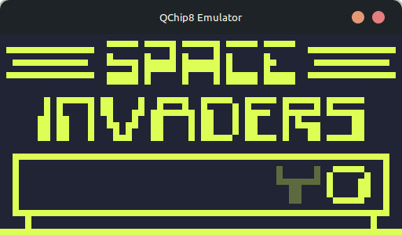
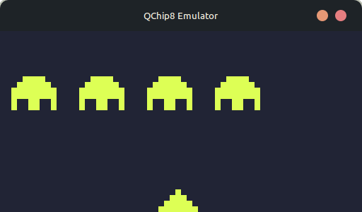

# QChip8-Emulator

[](https://github.com/mstuttgart/qchip8-emulator/actions/workflows/ci.yml) 

The QChip8 Emulator is a freeware open source RCA COSMAC VIP emulator and CHIP-8 interpreter for 
Microsoft Windows and GNU Linux, written in C. The emulator core (`src/chip8_cpu.c` and `src/chip8_system.c`)
has no dependency on any graphics library; the SDL2 frontend (`src/main.c`) is responsible for rendering the
display and forwarding keyboard input. QChip8 Emulator may be freely distributed, 
not for commercial purposes.If you want to reuse anything, go ahead, as long as you credit me, and your project is open source too.

<p align="center">
<a name="top" href="https://github.com/mstuttgart/qchip8-emulator"></a>
</p>


## Compiling

Make sure the SDL2 development libraries are installed:

```
* In Ubuntu/Debian: sudo apt-get install libsdl2-dev
* In Fedora: dnf install SDL2-devel
* In Arch Linux: pacman -S sdl2
```

Now you can compile by running:

```bash
make
```

This builds both the emulator (`chip8-emulator`) and the disassembler (`chip8-disassembler`).
You can now simply run QChip8 Emulator passing a ROM file:

```bash
./chip8-emulator "CHIP8 Roms/PONG"
```

## Testing

The emulator backend (CPU and system layer) has unit tests in `tests/`, with no external
dependencies. Run them with:

```bash
make test
```

<p align="center">
<a name="top" href="https://github.com/mstuttgart/qchip8-emulator"></a>
</p>

### Keyboard Configuration

Keyboard configuration in CHIP and it respective in PC keyboard:

|CHIP (PC)| CHIP (PC)| CHIP (PC) | CHIP (PC) 
:---:|:---:|:---:|:---:|
|1 (1)| 2 (2) |3 (3)| C (4)
|4 (Q)| 5 (W)| 6 (E)| D (R)
|7 (A)| 8 (S)| 9 (D)| E (F)
|A (Z) |0 (X)| B (C)| F (V)


* Space: start emulation (after a hard reset)
* P: pause/resume emulation
* Ctrl+U: soft machine reset
* Ctrl+R: hard machine reset (reload ROM)
* Ctrl+1 / Ctrl+2 / Ctrl+3: window size x0.5 / x1 / x2
* F1 - F5: color themes (Default, TELMAC/COSMAP, HP48, YellowBlues, LaraG)
* Ctrl+Q or Esc: exit emulator

## Documentation

CHIP-8 reference documentation:

* [CHIP-8 Instruction Set](https://multigesture.net/wp-content/uploads/mirror/goldroad/chip8_instruction_set.shtml)
* [Cowgod's CHIP-8 Technical Reference](http://devernay.free.fr/hacks/chip8/C8TECH10.HTM)

## Contributing

If you'd like to contribute, please create a fork and issue pull requests! I am
very open to newcomers, and will need all the help we can get to make the best
Chip8 emulator available.

### I found a bug!

Please report any and all bugs using the project issue
tracker. Be as precise as possible so that the bug can be found easier. Thanks!

## About

Copyright (C) 2014-2026 by Michell Stuttgart Faria

Internal RCA COSMAC VIP Operating System, CHIP-8 interpreters (C) Joseph Weisbecker 1977-1990(?)

